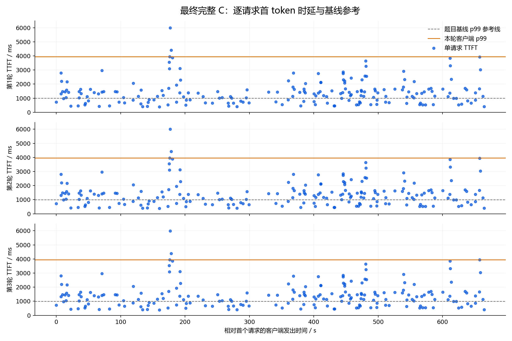

# 最终 C 尾时延的补充诊断

以下只读取最终三轮完整测试的客户端 SQLite，不再占用 GPU；它是关联分析，不是单独的因果实验。

横轴是客户端发出请求的相对时间，纵轴是该请求的首 token 时延。灰线是题目基线的 p99，只作分布参考，不是每一条请求的单独合格线；橙线直接采用各轮 EvalScope 的 p99，不重新计算另一套百分位。

| 轮次 | 本轮 TTFT p99 ms | 最慢请求输入 token | 最慢 TTFT ms | 发出时其他未完成客户端请求 |
|---|---:|---:|---:|---:|
| 1 | 3948.2632 | 13838 | 5993.84 | 5 |
| 2 | 3964.4639 | 13838 | 6014.23 | 5 |
| 3 | 3940.2434 | 13838 | 5985.99 | 5 |

输入长度与请求重叠都应纳入后续假设。客户端未完成请求数不能叫服务端队列深度；单靠此图也不能把耗时分配到 CPU、GPU 或某个算子。需要配合最终 profiler 的算子事件和服务端调度时间线，才能进一步设计隔离实验。

原始记录：`final-current/model/performance/r*/C/**/benchmark_data.db`；逐条前十名见 `final-C-tail-analysis.json`。
